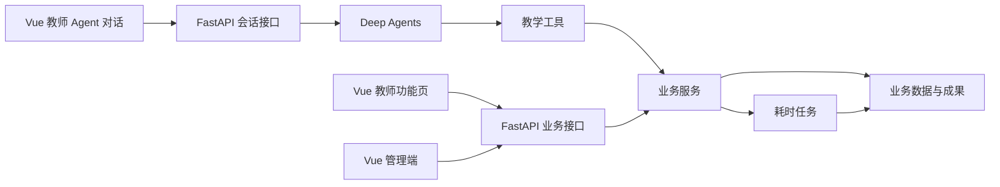

# 智能教育平台架构设计

状态为 v0.1 讨论稿，更新于 2026-11-11。

## 已确定的框架方向

| 层 | 框架 | 职责 |
| --- | --- | --- |
| 前端 | Vue | 管理端与教师端页面、教师 Agent 对话、生成任务进度与成果展示。学生端在教师端验收后启动。 |
| 后端 | FastAPI | 认证与权限校验、业务接口、Agent 会话接口，以及任务和成果的查询。 |
| Agent | LangChain Deep Agents Python SDK | 根据教师意图与所选上下文选择和串联业务工具，向对话返回任务状态和成果。 |

FastAPI 提供 OpenAPI 接口描述，Deep Agents 支持传入自定义工具。项目可以用后者注册教学操作，在两个入口复用同一套服务与权限校验。[Vue 文档](https://vuejs.org/guide/introduction.html) · [FastAPI 功能文档](https://fastapi.tiangolo.com/features/) · [Deep Agents 文档](https://docs.langchain.com/oss/python/deepagents/overview)

## 模块关系

1. **业务服务**负责课程与任课关系、素材和成果版本、试卷与作业、批改和学情。页面接口与 Agent 工具均调用业务服务，服务端按当前教师、学校、课程及教学班进行授权。
2. **工具调用**接受结构化参数与业务对象 ID。课程上下文由服务端校验。长任务返回任务 ID，页面和对话查询同一状态，成功后跳转到相同的成果版本。已确认成绩和公开反馈通过功能页完成。
3. **会话状态**保存教师可见的对话历史、所选业务上下文与工具执行结果。原始资料与教学成果保存在业务记录中。重试按任务标识查询或恢复已有操作，避免重复生成、批改或写入成绩。
4. **数字课程**由专用页面经业务接口编排。生成逐页口播稿、上传形象和参考语音、预览、渲染与导出均在该页面完成。Agent 可以提供页面入口。形象与参考音频按业务权限访问和使用。

## 待讨论的技术决策

- 首个验证组件为教案生成。用同一课程和资料，从功能页和对话分别提交生成请求，验证权限、任务状态、草稿记录和编辑行为。
- 后续按组件比较前端工程配套、数据库与对象存储、后台任务执行与重试、对话流式传输与会话持久化、模型与教学内容生成、数字人及语音方案。对比结论与验收样例按组件记录，确认后实施。
