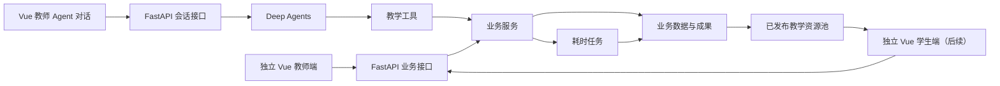

# 智能教育平台架构设计

状态为 v0.6，更新于 2026-11-24。具体依赖和变更依据见[技术栈与选型记录](technology-stack.md)，开发进度见开发日志。

## 已确定的框架方向

| 层 | 框架 | 职责 |
| --- | --- | --- |
| 前端 | Vue | 教师端与未来独立学生端。教师端包含 Agent 对话、生成任务进度与成果展示；管理端不再作为目标产品开发。 |
| 后端 | FastAPI | 认证与权限校验、业务接口、Agent 会话接口，以及任务和成果的查询。 |
| Agent | LangChain Deep Agents Python SDK | 根据教师意图与所选上下文选择和串联业务工具，向对话返回任务状态和成果。 |

FastAPI 提供 OpenAPI 接口描述，Deep Agents 支持传入自定义工具。项目可以用后者注册教学操作，在两个入口复用同一套服务与权限校验。[Vue 文档](https://vuejs.org/guide/introduction.html) · [FastAPI 功能文档](https://fastapi.tiangolo.com/features/) · [Deep Agents 文档](https://docs.langchain.com/oss/python/deepagents/overview)

## 模块关系

1. **业务服务**负责课程与任课关系、素材和成果版本、试卷与作业、批改和学情。教师页面、学生页面与 Agent 工具均调用业务服务；教师统计按任课范围授权，学生仅能访问公开发布的资源以及本人数据。
2. **工具调用**接受结构化参数与业务对象 ID。课程上下文由服务端校验。长任务返回任务 ID，页面和对话查询同一状态，成功后跳转到相同的成果版本。已确认成绩和公开反馈通过功能页完成。
3. **会话状态**保存教师可见的对话历史、所选业务上下文与工具执行结果。原始资料与教学成果保存在业务记录中。重试按任务标识查询或恢复已有操作，避免重复生成、批改或写入成绩。
4. **数字课程**由专用页面经业务接口编排。生成逐页口播稿、上传形象和参考语音、预览、渲染与导出均在该页面完成。Agent 可以提供页面入口。形象与参考音频按业务权限访问和使用。

## 待讨论的技术决策

- 首个验证组件为教案生成。用同一课程和资料，从功能页和对话分别提交生成请求，验证权限、任务状态、草稿记录和编辑行为。
- 后续按组件比较前端工程配套、数据库与对象存储、后台任务执行与重试、对话流式传输与会话持久化、模型与教学内容生成、数字人及语音方案。对比结论与验收样例按组件记录，确认后实施。

## 首次开发实现

- Vite 多入口构建。现有教师端入口是 `/`，历史学校管理端入口是 `/admin/`；管理端不再属于目标产品路线，保留仅为兼容。未来学生端使用独立应用入口。教师 Agent 使用教师端独立全页路由。
- FastAPI 提供同源 API。学校管理员和教师使用不同入口，后端校验账号角色、服务端会话、任课关系和资料或教案归属。
- SQLAlchemy 支持 SQLite 本地验收和 PostgreSQL 部署配置。资料原件位于私有目录，数据库保存逐页正文、树形目录和教案版本号。编辑使用带预期版本号的更新防止覆盖。
- 教案使用 DOCX Editor 进行分页编辑，已有结构化教案通过生成 DOCX 打开。Word 模板与实例独立保存。文本索引用于教师 Agent 查询，DOCX 为编辑和导出的正文版本。续写与重写调用独立的模型服务接口。
- 试卷沿用 Word 分页编辑和 LibreOffice 转换，独立保存 DOCX 正文、题目标记及教师答案。AI 单题采纳以 Word 书签定位，事务内更新正文、题目元数据和版本。导入卷的学生版由教师核对后导出。
- 资料、教案和 Word 模板使用同一 PDF.js 连续滚动预览。旧 DOC 转换与导出、Word 模板预览及新版教案 PDF 导出依赖 LibreOffice。
- 数字课程的讲稿与视频任务由独立 worker 读取 SQLAlchemy 队列。提交任务时检查项目修订号，视频任务保存脚本和所选素材的快照。教师端查询已持久化的任务状态，输出文件走同源授权的范围请求。GPU 推理与语音合成分别运行于独立模型环境。
- 思维导图和个人模板使用独立业务表与版本号。服务端验证节点树、资料归属和引用页码。AI 生成只输入所选范围内有正文的页面，用服务器分配的页号标记核对模型引用。内置模板从版本化 JSON 读取，前端按需加载编辑器并在浏览器导出整图 PNG。
- Agent 会话与消息按教师、课程保存，回复期间可排队或停止并引导。完整历史传给 Deep Agents，并由摘要中间件管理上下文。业务工具及对应 Skill 在 `backend/app/agent_tools/__init__.py` 显式注册。新模块以 `make_tools(run_tool, course_id)` 返回有类型的工具和结果组，复用教师权限和业务服务。带成果入口的模块配置成果卡片类型、标签和 Vue 路由，卡片与回复一并保存。当前覆盖资料、教案、导图、试卷、课件、题库、学情及数字课程状态。数字课程制作、题库发布、教案 Word 正文编辑由教师使用专用页面。

## 学情分析与共享目录方案（已批准，教师侧首版已实现）

学情分析由教师端专用工作区承载，CSV/XLS/XLSX 经字段映射、预览和教师确认后，标准化入 SQLAlchemy 事实表。导入 worker 处理已确认批次；图表由 Vue 内 Apache ECharts 显示。原件留在私有存储并可删除。教师可使用或保存大屏布局和字段映射。四类已发布资源由独立共享目录统一索引，保留各自内容存储和不可变发布版本。当前学生账号和入口尚未实现，学生端接入后再开放已发布目录和指定个人计划。详细边界和选型见[学情分析与资源共享设计](learning-analytics-design.md)。
