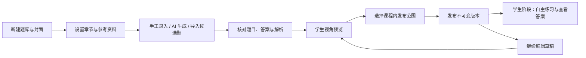

# 在线题库产品设计与技术选型 v0.1

日期：2026-11-19。产品定位已由负责人确认：自主练习，只生成和管理题库、答案并发布，不涉及成绩。本文件为本轮设计交付，具体编辑器及实现方案待负责人审阅；尚未安装新依赖或开发业务代码。学生端仍按既有约定在教师端之后实现。

## 1. 产品定位与交付边界

教师创建带封面的课程题库，按章节组织题目和答案，可手工编写、AI 生成或从现有试卷导入，核对后发布给课程内学生。学生后续进入题库按章节自主练习，填写答案、查看参考答案和解析、恢复练习进度。

在线题库以结构化题目为正文，以网页编辑和在线阅读为主要体验。借鉴试卷的题型、参考资料选择、公式输入和单题修改能力，不复用试卷的分页、分值、答题卡或打印版式。首版不设置成绩、排名、限时测验、正式考试、批阅工作台或学习诊断算法。

教师端首版包含题库新建与管理、封面、层级章节、题目与答案编辑、AI 批量生成、AI 单题修改、导入候选题、学生视角预览、发布和下架。学生账号开通、实际在线作答页面及进度保存放到学生端阶段，但发布版本与授权接口从本模块起按这一用途设计。

## 2. 教师使用流程

### 2.1 题库管理

- 独立的「在线题库」功能入口。列表以封面卡片展示，显示题库名称、课程、题量、发布状态与更新时间；支持检索和按状态筛选。
- 基本信息包括名称、简介、所属课程、封面、标签。新建时生成默认封面，无须上传图片即可使用。
- 支持重命名、修改简介、复制为新草稿、归档和删除未发布草稿。复制不继承发布范围或学生进度。
- 默认只有创建教师可以管理题库，同课程任课关系不自动授予其他教师编辑权限。跨教师共建作为后续独立授权能力。
- 有发布历史的题库优先下架、归档，保留发布版本；编辑和发布采用修订号，防止多窗口相互覆盖。
- 学生视角预览展示发布后实际布局、选项、公式与折叠的参考答案，不生成学生练习记录。

### 2.2 封面

- 统一 16:9。内置六套原创样式：极简学术、蓝白科技、暖纸书页、青绿自然、紫色几何、深色网格，支持配色和标题排版选择。
- 默认封面使用题库名称与课程信息自动排版，名称变化时更新草稿封面，已发布封面保持原版本。
- 支持上传 JPG、PNG、WebP，拖动和缩放确定裁剪区域。建议上限 5 MB、20 MP，服务端校验真实图片格式，输出 1200×675 封面及缩略图，并移除 EXIF。
- 系统默认图形使用受控原创 SVG 模板；上传图像由 Pillow 重新编码。封面和题目附件统一记录引用，替换草稿图片不删除发布版本正在使用的文件。

### 2.3 章节与题目

- 章节为父子树，可包含子章节；支持重命名、调整顺序和移动题目，避免只支持一级目录。接口校验循环引用及跨题库移动。
- 基础题型沿用单选、多选、判断、填空、解答。编程、证明、计算、实验分析等作为专业标签，不另建与基础作答方式重叠的顶级题型。
- 每题包含题干、选项或填空位置、参考答案、解析、所属章节、知识点标签、可选的教师预设难度、参考资料及审核状态；不包含分值。
- 题干、选项、答案与解析支持富文本；支持表格、上传的图片、代码块、行内及独立公式。公式可视面板与 LaTeX 双向编辑，复用矩阵、行列式、积分和多行公式能力。
- 单选/多选以稳定的选项 ID 保存正确选项，A/B/C/D 只是显示标签；填空以空位 ID 对应答案，可记录多个参考表达；解答题以富文本保存解题过程。
- 共享材料题使用独立材料和多个子题，子题仍采用上述基础题型，题量按子题统计。适用于阅读理解、一段代码对应多问等场景。
- 教师可逐题保存并确认，批量调整章节、标签与发布选择。未核对的 AI 结果、导入结果保留为待确认草稿。
- 图片首版解决上传与插入，不引入自动生成学科场景图；听力仍按既有约定在后续专题讨论。

### 2.4 AI 与资料挂载

- 生成前选择资料、章节或页码范围；可设置题型及数量、知识点、预设难度、语言、教学要求和解析详细程度。
- 建议每批 5–20 题，题库可通过多批生成逐步补充。长任务展示进度，已成功的候选题保留，失败项可重试。
- 输出为结构化题目、参考答案、解析和对应的资料页码。严格检查选项与答案对应关系、重复选项、空题干、非法公式和引用范围，模型生成结果仍需教师确认。
- 模型返回业务题目结构，由服务端转换为受控富文本节点；不直接接受模型生成的可执行 HTML 或任意编辑器节点。
- AI 单题修改支持改写题干、优化干扰项、调整难度、补充答案或解析、按要求替换；先展示候选，采纳后才写入草稿，不自动改动发布版本。
- 题库可挂载多份资料，每题可以保留更精确的来源页码。学生只获得题目发布内容及必要的来源名称、页码；发布题库不等于开放教师的整份原始资料。

### 2.5 从试卷或 Word 获取题目

- 支持从本人现有试卷选择已确认的题目，或上传 DOC/DOCX 提取候选题；导入后进入同一个结构化题目编辑器。
- 现有试卷的题干与选项在 DOCX 书签范围内，数据库 `Exam.questions` 主要保存答案等元数据，不能直接当成完整在线题目复制。
- 优先解析原生文本、题号和可识别公式，复用现有 LibreOffice、python-docx 和 OMML/LaTeX 转换。选项边界、题目范围、答案和复杂对象均提供教师核对。
- 首版导入的验收对象为文本可识别的常规试卷。扫描件、绘图对象、复杂浮动布局不宣称无损结构化；无法可靠解析的题目列出具体问题，允许教师补录，不静默丢弃。

## 3. 发布与学生端契约

### 3.1 发布规则

- 默认发布到本课程学生，可选择限制到本课程的一个或多个教学班；不做匿名公开题库市场。发布班级必须属于题库课程，教师须具有该课程的任课关系。
- 发布前预检封面、至少一道可发布题目、题干与答案完整性、公式有效性、审核状态及目标班级。问题逐项定位，教师处理或明确排除后发布。
- 一次发布生成固定版本，保存当时的标题、封面、章节、题目版本、答案和发布范围。后续编辑显示「有未发布修改」，学生仍看到原发布版本。
- 点击「发布更新」后，新进入的学生读取新版本；已开始练习的会话继续使用其固定版本，历史作答不被新答案覆盖。
- 支持下架。常规下架禁止新开练习，已开始的会话可继续完成；紧急撤回可同时停止继续读取和提交，保留既有记录。归档不等于删除历史数据。
- 首版按系统现有的课程级任课权限发布，不声称已有精确到教师与教学班的授权模型。如学校后续需要这一粒度，需先由管理端维护关联。

### 3.2 学生端的预期行为

- 以课程题库卡片进入，查看简介和章节，按顺序或章节自主练习。PC 和手机均能阅读并作答，答案编辑复用适合题型的控件。
- 参考答案与解析默认折叠，提交本题或点击「查看答案」后展示，服务于自学；不设计考试式防窥答案与成绩规则。
- 后续保存学生自己的输入、已练题目和最后位置，用于继续练习。练习进度与具体发布/题目版本关联，题目更新可提示重新练习。
- 教师端本轮不增加学生成绩、批阅、排名或学情报表。学生端的作答保存接口在学生阶段开发，不将接口占位当作已实现的在线答题。

### 3.3 当前必须明确的接入条件

现有系统已保存 `Student`、`ClassGroup`、`Enrollment`，但学生名册并不等于登录账号：`Credentials.role` 只接受教师和管理员，个人资料接口也只按教师任课关系查询课程。

学生端阶段必须在独立管理端补充学生账号开通与名册绑定，增加唯一的 `User ↔ Student` 关联，扩展学生登录及其课程查询，并提供独立学生入口。教师端可先完成题库及发布管理，但只有学生身份、授权和真实作答闭环验收通过后，才标记「学生在线答题已可用」。

学生读取题库、题目、封面和附件时均校验账号、课程选课、发布范围及发布状态。教师的草稿、AI 提示和私有原始资料不能通过学生接口返回。题目与答案使用独立响应模型，避免无意把未发布版本或答案字段混入列表。

## 4. UI 方案

- 题库首页延续 Dianoia 现有亮暗主题和紫色强调色，用封面网格展示内容；右上角保留明确的「新建题库」「AI 生成」「导入题目」入口。
- 编辑页顶部显示题库名称、保存状态、学生视角预览和发布入口；章节树、题目列表与当前题目编辑区域按工作流布局，当前编辑区优先保证宽度。
- 题目编辑将「题干与选项」「参考答案与解析」「资料来源」清晰区分；支持完整页预览，公式键盘不挤占输入框。
- 发布设置集中展示目标课程/班级、确认题量、封面和需要处理的问题，并区分「发布新题库」与「发布更新」。
- Agent 保持已有独立功能窗口，题库编辑页不另设 Agent 侧边栏。

## 5. 技术选型建议

| 模块 | 建议方案 | 对比与理由 |
| --- | --- | --- |
| 页面与接口 | 现有 Vue 3 + FastAPI + Pydantic | 复用课程上下文和会话认证，题库采用独立模块，页面与 Agent 共用业务服务。 |
| 网页富文本 | Tiptap 3.34.0 开源核心、Vue 3 适配、StarterKit、图片和表格扩展，配套包统一锁版本 | 2026-11-19 核对 npm 发布版本与 MIT 许可。相比 Word 分页编辑，更适合独立字段、结构化题目和手机阅读；相比集成完整 Moodle，保留现有课程与 Agent 架构。未选择付费协作、分页或供应商 AI 服务。 |
| 公式 | 现有 MathLive 0.111.4 + KaTeX 0.16.47，自定义编辑器公式节点 | 复用 `FormulaEditor.vue` 与公式渲染配置；保存 LaTeX 源码，支持重新编辑，避免把公式转成不可编辑的位图。 |
| 正文格式 | 有版本号的受控 JSON 文档 | Tiptap 官方建议 JSON 持久化。服务端验证节点、属性、文档深度、长度及附件归属；只接受预定义内容类型，粘贴内容转为该模型，不保存可执行 HTML。 |
| 数据 | 现有 SQLAlchemy 2；本地 SQLite，正式部署 PostgreSQL | 题目和发布快照用独立关系表；富文本内容用 JSON。查询优先用课程、章节、题型、标签和标题，无需为本模块新增向量数据库。 |
| 迁移 | 建议 Alembic 1.20.1 | 2026-11-19 核对 PyPI。为现有数据库建立基线，本模块新表通过版本化迁移建立，避免只依赖启动时 `create_all`。实施前在现有数据副本演练。 |
| 封面与图片 | 现有 Pillow、私有文件目录、受控默认 SVG；数据库保存文件信息与引用 | 原生裁剪预览加服务端裁剪，不为首版新增图片设计平台或裁剪库。未来可将文件存储替换为对象存储，业务只引用资源 ID。 |
| AI 生成 | 现有模型 API、资料页读取；结构化校验和教师采纳 | 不调用 Word 排版生成接口；从试卷模块提取可复用的资料与模型能力，题库建立无分值的独立 Schema。 |
| 耗时任务 | 复用现有数据库任务、租约和心跳的实现模式，使用题库自己的任务与 worker | 生成任务可恢复、候选可保留；不把题库生成塞进 GPU 数字课程 worker。题目按任务/输出序号去重，避免重试重复入库。本轮规模不新增 Redis/Celery。 |

上述版本是候选基线，不代表已经安装或完成兼容性验收。获批后先验证 Tiptap、公式、粘贴、图片与中文输入组合，再更新依赖与锁文件。题库编辑器不替换现有教案/试卷的 Word 编辑器。

### 5.1 推荐数据边界

| 对象 | 关键职责 |
| --- | --- |
| `QuestionBank` | 课程、归属教师、名称、简介、草稿封面和修订号。 |
| `BankSection` | 父子章节、排序与题库归属。 |
| `BankQuestion` / `QuestionVersion` | 题目标识、当前内容、类型、状态及不可变的历史题目内容。 |
| `QuestionAnswer` | 对应题目版本的参考答案与解析，避免直接复用学生题目响应。 |
| `QuestionMaterial` | 可选的共享材料与子题关系。 |
| `BankRelease` / `ReleaseQuestion` | 发布元信息、范围、章节快照与固定的题目版本引用。 |
| `QuestionAsset` / `QuestionSource` | 封面/插图及授权资料引用，保存来源页码。 |
| `BankGenerationJob` | AI 任务、进度、失败原因和已生成候选。 |
| 学生阶段：`StudentAccount` / `PracticeProgress` | 学生身份绑定及个人练习输入、进度，后续独立迁移。 |

只发布完整、不可变的题目版本。发布操作在事务内检查题库修订号并生成快照；并发修改返回冲突，不产生半新半旧的发布结果。发布记录采用请求幂等键，避免重复点击生成多个版本。

### 5.2 Agent 工具与 Skill

首版提供题库列表、题库信息、章节与题目读取、新建草稿、按资料生成候选题、修改草稿题目及答案、查看生成进度等工具。返回题库/题目 ID 和可打开的编辑地址。

Skill 说明当前课程范围、题型 Schema、资料页码引用及候选采纳规则。工具调用复用页面的服务与权限。AI/Agent 写入的内容标记待确认，首版最终发布在功能页预览后完成，与现有架构中公开教学内容的确认方式一致。

## 6. 可行性与依据

- 产品参考 Moodle 的题库分类/子分类、题目复用及预览，以及问题反馈方式；Dianoia 选择自主练习的内容发布流程，不照搬完整测验配置。[Moodle 题库](https://docs.moodle.org/501/en/Question_bank) · [反馈行为](https://docs.moodle.org/501/en/Question_behaviours)
- Tiptap 有官方 Vue 3 接入方案和 JSON 持久化建议，开源核心采用 MIT。可以把题目内容、公式源码和附件引用从 Word 页面中分离。[Vue 3](https://tiptap.dev/docs/editor/getting-started/install/vue3) · [JSON 持久化](https://tiptap.dev/docs/editor/core-concepts/persistence) · [许可](https://github.com/ueberdosis/tiptap/blob/main/LICENSE.md)
- 2026 年 SagE-QG 研究在阅读理解题目生成中强调技能目标与证据的明确关联。因此本产品要求知识点、资料范围和题目来源可追溯。该研究不构成对所有学科生成正确性的保证，尤其不能据此省去数学题答案核对。[SagE-QG](https://aclanthology.org/2026.findings-emnlp.424/)
- 2025 年高校 AI 形成性练习与反馈研究讨论了题目和反馈的质量指标及课堂应用。这里采用「生成候选—教师核对—自主练习—查看解析」作为产品设计推论，不直接引入论文模型或宣称学习效果已经在本平台验证。[AI-Generated Formative Practice and Feedback](https://aclanthology.org/2025.aimecon-main.36/)

主要风险是 Word 结构化导入的保真度、AI 答案正确性和发布版本一致性。分别用可修正的导入候选、教师核对、事务快照与权限验证处理。学生登录是现有系统的待补能力，不在本轮设计中假定已经实现。

## 7. 分步实施与验收

1. 编辑器验证与基础题库：创建、封面、章节/子章节、五类题目、共享材料、答案解析、保存重开与学生视角预览。
2. 生成与导入：按资料章节/页码批量生成，单题修改，试卷/Word 候选导入，部分失败保留与去重；接入 Agent 草稿工具。
3. 教师发布：预检、课程/班级范围、不可变发布版本、更新、下架与归档。管理页明确这是教师端交付，学生作答另行验收。
4. 学生端阶段：管理端开通学生账号、独立学生入口、已发布题库访问、在线输入、查看答案与解析、继续练习；验证非本班/本课程访问隔离。

必要自动化验证覆盖发布前校验、题目与答案一致性、版本冻结、授权隔离、重复发布/生成重试、公式保存重开。内容质量和 UI 体验由负责人使用真实课程验收，不为纯样式变更堆砌测试。
